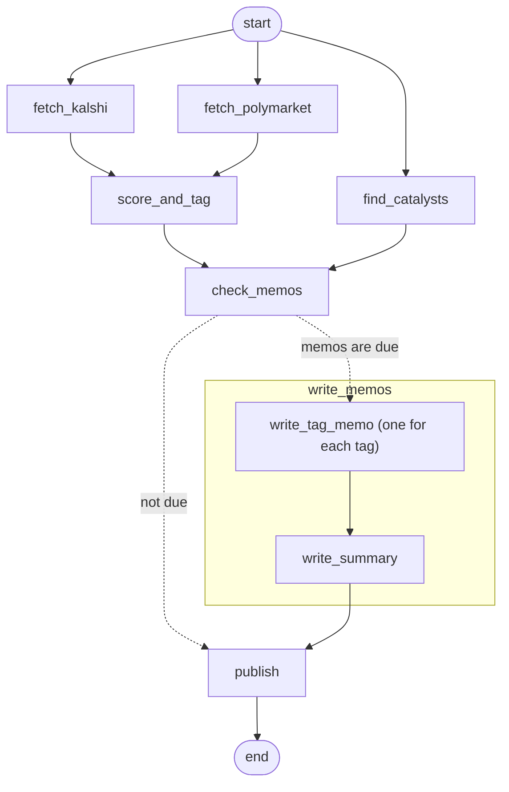

# zeitgeist [](https://github.com/pathikrit/zeitgeist/actions/workflows/daily_report.yml)
Daily forward-looking dashboard for an equities investor: prediction markets -> LLM relevance filter -> timeline of what resolves when

1. Fetch every open market from Kalshi and Polymarket
2. Ask the OpenAI [Decisions API](https://developers.openai.com/api/docs/guides/decisions) one question per market: is it relevant to the investor described in `templates/about_me.mako`, and if so which tag fits it (Crypto, Macro, Commodities, Market, Geopolitical, International, Govt, Calamities or Other)?
   - The answer has a probability for each choice. A market is kept when the tags together are at least as likely as "Not relevant", and gets its most likely tag
   - Answers are cached in a SQLite database, so each run only asks about markets it has not seen (or all of them again if the prompt changes)
   - The prompts in `templates/` are written in ASD-STE100 Simplified Technical English
3. Add upcoming catalysts, each with an expected date and a tag
4. Once a week (`MEMO_INTERVAL_DAYS` in `zeitgeist.py`), write the memos with a reasoning model that can search the web:
   - one memo for each tag, from that tag's questions and catalysts: what is priced in, and the second-order effects (who the candidates are and what they stand for, not only who is ahead)
   - one combined memo that condenses the tag memos into a single page
5. Publish `output.json` + `index.html` to GitHub Pages
   - Left to right: a timeline index, the questions and catalysts as cards in date order, and the memo
   - Selecting tags filters the cards and swaps the combined memo for the memos of those tags
   - `index.html` has no build step: [Astryx](https://astryx.atmeta.com/) components, [noUiSlider](https://refreshless.com/nouislider/) (the ruler of the timeline index) and Font Awesome icons load from CDNs

## Pipeline
The run is one [LangGraph](https://docs.langchain.com/oss/python/langgraph/overview) graph (`pipeline` in `zeitgeist.py`):



The prompts are [Mako](https://www.makotemplates.org/) templates in `templates/`: `about_me.mako` is included everywhere, and the two memo prompts inherit their shared parts from `memo_base.mako`.

## Database
`zeitgeist.db` (SQLite) is stored as an asset on the [`data` release](https://github.com/pathikrit/zeitgeist/releases/tag/data); the daily job downloads it, updates it and uploads it again.
- `markets`: every traded market seen in the last 30 days with its relevance score, tag and resolution date
- `snapshots`: daily odds and volume of the relevant markets
- `memos`: the latest memos, shown until the next ones are written

## Today's Dashboard
- <https://pathikrit.github.io/zeitgeist/>

### Install & run
```shell
git clone git@github.com:pathikrit/zeitgeist.git
cd zeitgeist
cp .env.example .env # then fill in OPENAI_API_KEY
uv run python zeitgeist.py
```

To work on the memo prompts without an API key, write the memos for a saved report with the local Codex CLI (`codex` on the `PATH`, or `CODEX_BIN`):
```shell
MEMO_MODEL=gpt-6-astra uv run python zeitgeist.py memos .reports/output.json          # every tag, then the summary
MEMO_MODEL=gpt-6-astra uv run python zeitgeist.py memos .reports/output.json Macro   # only these tags
```
